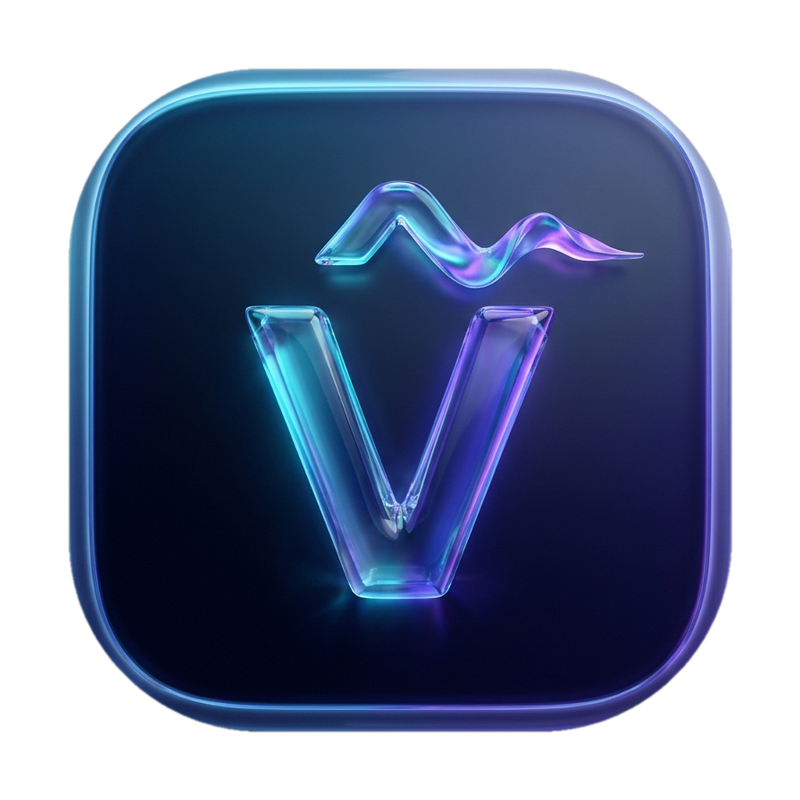

<div align="center">



# VFlow

### Next-Generation Native macOS Bilingual Vietnamese-English Input Engine, 3-Tier Contextual Suggestions & Live Caret HUD

[](https://swift.org)
[](https://apple.com/macos)
[-0071E3?style=flat-square&logo=apple&logoColor=white)](https://apple.com)
[](https://github.com/TGalioAutomation/VFlow)
[](https://github.com/TGalioAutomation/VFlow)
[](https://github.com/TGalioAutomation/VFlow)
[](Package.swift)
[](https://github.com/TGalioAutomation/VFlow/releases/latest)
[](LICENSE)

[**Website & Live Demo**](https://tgalioautomation.github.io/VFlow/) • [**Download Latest Release**](https://github.com/TGalioAutomation/VFlow/releases/latest) • [**Release Notes**](RELEASE_NOTES.md) • [**Bug Audit Report**](BUG_AUDIT_REPORT.md)

</div>

---

## 🌟 Overview

**VFlow** is a breakthrough native macOS bilingual input method engine, intelligent 3-tier suggestion assistant, and push-to-talk voice dictation companion engineered in **Swift 6** for Apple Silicon. 

Traditional Vietnamese input methods constantly suffer from false-trigger diacritics when typing English words (e.g., `ary` turning into `ảy`, `subclass` turning into `subcláss`, `arrow` turning into `arrơ`), laggy event loops, or invasive cloud logging. VFlow fundamentally solves this with a **deterministic Finite State Machine (FSM)**, smart English auto-escape, zero third-party dependencies, an ultra-low-latency 120fps live Caret HUD pill, and 100% on-device AI inference.

---

## ✨ Key Features

### 1. 🧠 Intelligent Bilingual Auto-Escape (Telex & VNI)
- **Zero Conflict English Typing**: Seamlessly detects genuine English words and programming syntax (`array`, `arrow`, `error`, `carry`, `sorry`, `class`, `subclass`, `pass`, `coffee`, `diff`, `off`, `window`, `import`, `const`) and prevents diacritic corruption.
- **Intervocalic Tone Letter Escape**: Distinguishes English suffixes like `-ary`, `-ory`, `-ery` from Vietnamese tones (e.g., typing `salary` preserves `salary` instead of mangling to `salảy`).
- **Free-Order Keystroke Tone Placement**: Allows typing tone marks anywhere in the syllable (e.g., `vieest` or `toasn` cleanly produces `viết` and `toán` without reverting to raw ASCII).
- **Auto-Diacritic Shorthand Expansion**: Instantly expands informal Vietnamese teencode (`ko` → `không`, `dc`/`đc` → `được`, `trc` → `trước`, `ntn` → `như thế nào`, `mn` → `mọi người`) on spacebar.
- **Instant Tone Removal**: Cleanly clears diacritics using `z` (Telex) or `0` (VNI) even after backspace editing.

### 2. ⚡ 3-Tier Contextual Suggestions & Live Text Polisher
Floating seamlessly beside your cursor, VFlow presents three tiers of real-time intelligence:
- **`⚡` Tier 1: Instant Diacritics & Teencode Expansion** — Restores full accents or expands common shorthand tokens with single-key acceptance (`⇥ Tab` or `⌥1`).
- **`✨` Tier 2: On-Device AI Typo & Grammar Polish** — Fixes contextual typos (e.g., `"to đang"` → `"tôi đang"`, `"không cau"` → `"không dấu"`, `"thaat sư"` → `"thật sự"`), removes verbal filler words (*"à"*, *"ừm"*, *"thì là mà"*), and offers 3 tone styles: **Natural**, **Polite**, and **Concise**.
- **`🔮` Tier 3: Next-Word Collocation Prediction** — Neural N-gram prediction that anticipates your next thought based on natural Vietnamese collocations.

### 3. 🫧 120fps Live Caret HUD (Prototype v8 Liquid Glass)
- **Caret-Tethered Floating Pill**: Follows your text cursor in real time across any macOS application (Safari, Chrome, Slack, Notes, Cursor, Xcode, Terminal, Zalo).
- **Non-Activating AppKit Panel**: Never steals key focus or disrupts window hierarchy (`.nonActivatingPanel`, `canBecomeKey = false`).
- **120fps Silk Sine Wave**: Two-tiered Cyan (`#38BDF8`) & Violet (`#A855F7`) fluid sine-wave animation that dynamically vibrates with voice audio levels and settles into a serene resting state.
- **Smart Multi-Monitor Clamping**: Automatically detects active monitor boundaries, prevents offscreen clipping, and flips vertically when typing near screen edges.

### 4. 🎙️ Push-to-Talk Voice Dictation (`⌥Space`)
- **Hold-to-Talk & Tap-to-Talk**: Hold `⌥Space` (Option + Space) or tap to speak in natural Vietnamese.
- **High-Accuracy SFSpeechRecognizer & CoreML**: Live streaming transcript displayed directly inside the Caret HUD.
- **Auto-Punctuation & Direct Text Injection**: Smoothly cleans spoken speech and injects the formatted text directly into the focused application via native accessibility APIs.

### 5. 🎛️ Bento Control Center & Retina Menu Bar
- **Menu Bar Capsule Badge**: Displays crisp live status (`[• VI·T]` for Telex, `[• VI·V]` for VNI, `[• EN]` for English).
- **1-Click Quick Toggle**: Right-click or `⌥-Click` the menu icon to toggle between Vietnamese and English.
- **Bento Settings Window**: Four beautifully organized tabs:
  - *Dashboard*: Live telemetry, keystroke statistics, and feature toggles.
  - *Input & Macros*: Telex/VNI selection, tone placement styles (Modern `hòa` vs Classic `hoà`), and custom abbreviation expansion.
  - *AI & Model Hub*: Local LLM selector (Rule-based, Apple Foundation Models, CoreML Whisper / Qwen).
  - *Appearance & HUD*: Wave speed, opacity, scale, and theme controls.
- **Live Interactive Sandbox**: Test your typing, suggestion shortcuts, and tone changes live inside the settings window.

### 6. 🛡️ 100% On-Device Privacy & Security
- **Zero Cloud Calls**: No data leaves your Mac. 100% offline rule-based and CoreML neural models.
- **Zero Third-Party Dependencies**: Built exclusively with Apple system frameworks (`AppKit`, `SwiftUI`, `CoreGraphics`, `ApplicationServices`, `Speech`, `AVFoundation`, `os`).
- **Zero Telemetry / Keylogging**: Keystrokes are processed strictly in volatile memory and never stored, logged, or transmitted.

---

## 💻 System Requirements

| Requirement | Specification |
|---|---|
| **Operating System** | macOS 14.0 (Sonoma), macOS 15.0+ (Sequoia / Tahoe) |
| **Hardware** | Apple Silicon (M1, M1 Pro/Max/Ultra, M2, M3, M4 series) |
| **Toolchain** | Xcode 15.0+ / 16.0+ with Swift 6.0+ |
| **Permissions** | Accessibility (`AXIsProcessTrusted`), Input Monitoring (`CGEventTap`), Microphone (`AVCaptureDevice`), Speech Recognition (`SFSpeechRecognizer`) |

---

## 🚀 Installation & Quick Start

### Option 1: Direct Download (Pre-built DMG / ZIP)

1. Download the latest release from the [**Releases Page**](https://github.com/TGalioAutomation/VFlow/releases/latest):
   - **DMG Package**: [`VFlow-v1.0.1-macOS-arm64.dmg`](https://github.com/TGalioAutomation/VFlow/releases/latest/download/VFlow-v1.0.1-macOS-arm64.dmg)
   - **ZIP Archive**: [`VFlow-v1.0.1-macOS-arm64.zip`](https://github.com/TGalioAutomation/VFlow/releases/latest/download/VFlow-v1.0.1-macOS-arm64.zip)
2. Open the `.dmg` file and drag **VFlow.app** into your `/Applications` folder.
3. Launch VFlow from `/Applications` or via Spotlight (`⌘Space` → "VFlow").

### Option 2: Build from Source

```bash
# 1. Clone the repository
git clone https://github.com/TGalioAutomation/VFlow.git
cd VFlow

# 2. Run the test suite (186 tests)
DEVELOPER_DIR=/Applications/Xcode.app/Contents/Developer swift test

# 3. Build and package the signed application bundle
./scripts/build_app.sh

# 4. Or produce full distributable release packages (.dmg, .zip, SHA256SUMS.txt)
./scripts/package_release.sh
```

The resulting application is placed in `build/VFlow.app`, and distributables are placed in `build/release/`.

---

## 🔐 macOS Permissions Setup

VFlow requires the following standard macOS permissions to intercept input and position the Caret HUD:

1. **Accessibility (`Quyền Trợ năng`)**:
   - Go to **System Settings** → **Privacy & Security** → **Accessibility**.
   - Enable **VFlow** (allows cursor tracking and caret bounds reading via `AXUIElement`).
2. **Input Monitoring (`Quyền Giám sát Đầu vào`)**:
   - Go to **System Settings** → **Privacy & Security** → **Input Monitoring**.
   - Enable **VFlow** (allows keystroke processing via low-level `CGEventTap`).
3. **Microphone & Speech Recognition (Optional, for Voice Dictation)**:
   - When first using Push-to-Talk (`⌥Space`), click **OK** to grant Microphone and Speech Recognition access.

---

## ⌨️ Keyboard Shortcuts Reference

| Shortcut | Action | Description |
|---|---|---|
| `⌥Z` *(Option + Z)* | Toggle Input Method | Quickly switch between Vietnamese (`VI·T` / `VI·V`) and English (`EN`). |
| `⌥Space` *(Option + Space)* | Push-to-Talk | Hold to speak Vietnamese voice dictation; release to inject text. |
| `Tab` or `⌥1` | Accept Suggestion 1 | Accepts Tier 1 `⚡` Instant Diacritic or Teencode Expansion. |
| `⌥2` | Accept Suggestion 2 | Accepts Tier 2 `✨` On-Device AI Typo & Grammar Polish. |
| `⌥3` | Accept Suggestion 3 | Accepts Tier 3 `🔮` Next-Word Prediction. |
| `Esc` | Dismiss Caret HUD | Temporarily closes the floating Caret HUD for the current word. |
| `⌘Z` *(Cmd + Z)* | Undo Correction | Reverts the last auto-corrected word back to raw keystrokes. |

---

## 🏗️ Architecture & Codebase Layout

VFlow is structured into modular Swift targets following strict separation of concerns and Swift 6 concurrency principles:

```
VFlow/
├── Package.swift                     # Pure Swift 6 package manifest (0 third-party dependencies)
├── Sources/
│   ├── VFlowCore/                    # Pure algorithmic core (0 AppKit dependency, 100% portable)
│   │   ├── Engine/                   # FSM input engine, Telex/VNI rules, English detector, SuggestionEngine
│   │   ├── Polish/                   # Rule-based polisher, teencode dictionary, tone placement
│   │   ├── AI/                       # LocalLLMProvider protocol, RuleBasedLLMStub, ModelHubConfig
│   │   └── State/                    # TypingBuffer, PerAppStateManager
│   ├── VFlowPlatform/                # macOS system services & hardware hooks
│   │   ├── EventTap/                 # CGEventTapHook, KeyCodeMap, thread-safe event swallowing
│   │   ├── Accessibility/            # AccessibilityBridge, CaretLocator, AutocompleteDetector
│   │   ├── Injection/                # DirectTextInjector, ClipboardFallback
│   │   └── Voice/                    # PushToTalkMonitor, VoiceDictationService (SFSpeechRecognizer)
│   ├── VFlowUI/                      # High-craft AppKit + SwiftUI Liquid Glass presentation
│   │   ├── CaretPill/                # CaretPillWindow (NSPanel non-activating), CaretPillView, SilkSineWave
│   │   ├── MenuBar/                  # MenuBarCoordinator, BentoMenuView (Retina popup)
│   │   └── Settings/                 # BentoSettingsWindow (4-tab dashboard, sandbox, model hub)
│   └── VFlowApp/                     # App entry point & multi-target coordinator
│       ├── AppDelegate.swift         # Lifecycle, permission onboarding, global event routing
│       └── main.swift                # Native application startup
├── Tests/
│   └── VFlowTests/                   # 186 Unit, integration & adversarial regression tests
│       ├── VietnameseEngineTests.swift
│       ├── VietnameseSuggestionAccuracyTests.swift
│       ├── AdversarialBoundaryStressTests.swift
│       ├── DeepBugDiscoveryTests.swift
│       └── NewFeaturesVerificationTests.swift
├── scripts/
│   ├── build_app.sh                  # Builds release binary, creates bundle, iconset, Info.plist, codesign
│   └── package_release.sh            # Packages DMG with /Applications symlink, ditto ZIP, SHA256SUMS
├── docs/                             # Flagship promotional landing website
│   ├── index.html                    # Liquid Glass promotional page with interactive live typing demo
│   └── assets/                       # 3D Liquid Glass assets (app_icon, voice_orb, neural_core)
└── build/                            # Local release bundles & distributables
    └── release/                      # VFlow-v1.0.1-macOS-arm64.dmg, .zip, SHA256SUMS.txt
```

---

## 📊 Release Readiness Scorecard (v1.0.1)

| Audit Domain | Acceptance Standard | Verified Status | Evidence |
|---|---|---|---|
| **Test Suite Coverage** | 100% Pass Rate across all unit & adversarial suites | **PASSED** (186/186) | `Executed 186 tests, with 0 failures` |
| **Swift Concurrency** | Swift 6 strict concurrency compliance | **PASSED** | Zero warnings under `@MainActor` and `NSLock` |
| **Clean-Room Mutants** | 3/3 Broken Mutants killed | **PASSED** (100% Kill) | Mutants 1, 2, and 3 failed expectedly |
| **Third-Party Bloat** | Zero third-party dependencies | **PASSED** | `dependencies: []` in `Package.swift` |
| **Code Signing** | Valid deep codesign verification | **PASSED** | `build/VFlow.app: satisfies its Designated Requirement` |
| **Linker Hygiene** | System frameworks only, no user dylib leaks | **PASSED** | `otool -L` confirms 100% `/System/Library` paths |
| **Path Decoupling** | Zero hardcoded `/Users/...` machine paths | **PASSED** | `grep -rn "/Users" Sources/` returns 0 matches |
| **Log Hygiene** | Zero debug `print()` spam in production paths | **PASSED** | `os.Logger` structured logging only |
| **Distributable Packages** | Valid DMG, ZIP, and matching SHA-256 | **PASSED** | Passes `shasum -a 256 -c SHA256SUMS.txt` |

---

## 🔒 Verification & Checksums (v1.0.1)

To verify the integrity of downloaded release packages:

```bash
# Verify checksums using shasum
shasum -a 256 -c SHA256SUMS.txt
```

### Official SHA-256 Hashes

```text
a354d13294985719712a1eecd994a5212278759ae1b4d38f35c5ade40ee053de  VFlow-v1.0.1-macOS-arm64.dmg
9d04c0a9b64e3330200478e35ee7a8bedd77078635d33787830b88424c7ed069  VFlow-v1.0.1-macOS-arm64.zip
```

---

## 📄 License

VFlow is distributed under the **MIT License** and **Apache License 2.0** (dual-licensed). See the [LICENSE](LICENSE) file for details.

---

<div align="center">
Crafted with ❤️ for the macOS Vietnamese Community by the VFlow Engineering Team.
</div>
